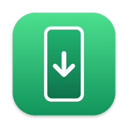
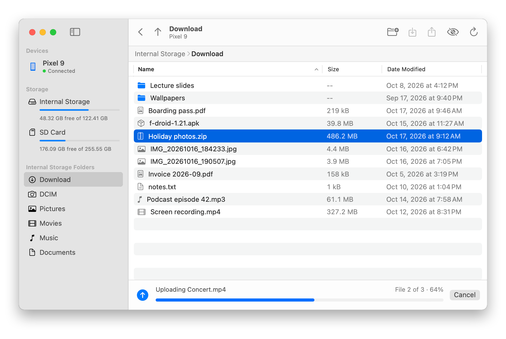

<p align="center">
  
</p>

<h1 align="center">DroidDrop</h1>

<p align="center">
  <b>Drag and drop files between your Mac and your Android device over USB.</b><br>
  Free, native, tiny, and it can actually <i>write</i> to your phone.
</p>

<p align="center">
  
  
  
</p>

<p align="center">
  <picture>
    <source media="(prefers-color-scheme: dark)" srcset="docs/screenshot-dark.png">
    
  </picture>
</p>

---

## Why

Getting a file from a Mac onto an Android device should be easy, but it rarely is. Google's
Android File Transfer is abandoned and flaky. The polished alternatives cost money, and some
of them are read-only unless you pay.

DroidDrop is a small native app that does the one job well: you see your device's storage
like a Finder window, drag files in, and they land on the device. It uses `adb`, the official
Android tool, so it's fast and reliable, and it works with any Android device that has USB
debugging turned on.

## Features

- **Drag and drop uploads.** Drop files or whole folders from Finder onto the window, with
  live progress and a Cancel button.
- **Downloads.** Pull files and folders back to your Mac. DroidDrop shows them in Finder when
  the download finishes.
- **Internal storage, SD cards, and USB drives.** Each one appears in the sidebar with a
  free-space gauge.
- **Quick folders.** Shortcuts to Download, DCIM, Pictures, Movies, Music, and Documents
  on whichever storage you're browsing.
- **File management.** New folder, rename, and delete (with confirmation), from the toolbar or
  the right-click menu.
- **Finder-style browsing.** Sortable columns, a clickable path bar, back and up buttons, and a
  toggle for hidden files.
- **Setup help.** If no device is connected, the device hasn't granted permission yet, or it
  went offline, DroidDrop explains what to do.
- **Native and small.** Pure SwiftUI with no dependencies. The whole app is about 1 MB.

## Getting started

### 1. Install `adb`

If you have Android Studio, you already have it. Otherwise, install it with Homebrew:

```sh
brew install android-platform-tools
```

DroidDrop looks for `adb` in `$ANDROID_HOME`, `~/Library/Android/sdk/platform-tools`,
`/opt/homebrew/bin`, and `/usr/local/bin`.

### 2. Turn on USB debugging on your device

1. **Settings → About phone** → tap **Build number** 7 times to unlock Developer options.
2. **Settings → System → Developer options** → turn on **USB debugging**.
3. Plug the device into your Mac. When **"Allow USB debugging?"** appears on the device,
   tick **Always allow from this computer** and tap **Allow**.

### 3. Install DroidDrop

**Download it.** Get the latest `DroidDrop-<version>.dmg` from
[Releases](https://github.com/gabacode/DroidDrop/releases), open it, and drag DroidDrop onto
the Applications folder. It runs on Apple silicon and Intel Macs.

DroidDrop isn't notarized by Apple, so macOS blocks the first launch. Try to open it once,
then go to **System Settings → Privacy & Security** and click **Open Anyway**. You only have
to do this once.

**Or build it yourself.** You'll need Xcode or the Xcode Command Line Tools (Swift 5.10 or
later).

```sh
git clone https://github.com/gabacode/DroidDrop.git
cd DroidDrop
make install
```

This builds the app and copies it to `~/Applications`. Run `make` on its own to list every
command:

| Command | What it does |
| --- | --- |
| `make build` | Build `build/DroidDrop.app` |
| `make run` | Build and launch the app |
| `make install` | Build and copy the app to `~/Applications` (change with `INSTALL_DIR=…`) |
| `make uninstall` | Remove the installed app |
| `make universal` | Build `build/DroidDrop.app` for Apple silicon and Intel (needs Xcode) |
| `make dmg` | Package the universal app, README, and LICENSE into `build/DroidDrop-<version>.dmg` |
| `make clean` | Delete all build output |

The version comes from `Resources/Info.plist`. To build a different one, pass it in, for
example `make dmg VERSION=1.2`.

## Using it

| Action | How |
| --- | --- |
| Upload | Drag files from Finder onto the window, or **⌘U** |
| Download | Select items, then **⌘D** (or double-click a file) |
| Open a folder | Double-click it |
| Back / enclosing folder | **⌘[** / **⌘↑** |
| New folder | **⇧⌘N** |
| Rename | Right-click → Rename… |
| Delete | **⌫**, or right-click → Delete… |
| Show hidden files | **⇧⌘.** |
| Refresh | **⌘R** |

Uploads go into the folder you're currently looking at.

## How it works

DroidDrop runs the `adb` command-line tool for you. The app has three main parts:

| File | Role |
| --- | --- |
| [`ADB.swift`](Sources/DroidDrop/ADB.swift) | Async wrapper around `adb`: devices, storage, folder listings, file operations, transfers |
| [`AppModel.swift`](Sources/DroidDrop/AppModel.swift) | App state: device polling, navigation, upload and download queue |
| [`Views.swift`](Sources/DroidDrop/Views.swift) | The SwiftUI interface: sidebar, file table, path bar, transfer bar, drop target |

Some implementation details:

- **Transfer progress.** `adb push` and `adb pull` print their `[ 42%]` progress only when
  they think they're writing to a terminal. DroidDrop gives them one: it opens a
  pseudo-terminal with `openpty` and reads the progress from it.
- **Folder listings.** Instead of parsing `ls`, DroidDrop runs toybox
  `stat -L -c '%F|%s|%Y|%n'` on the device, which prints one machine-readable line per file.
- **Storage detection.** SD cards and USB drives are the mount points under `/storage/*`.
  `df` gives their capacity, and `sm list-volumes` tells an SD card from a USB drive.
- **Device polling.** `adb devices -l` runs every 1.5 seconds, so plugging in a device or
  tapping **Allow** shows up in the app right away.

`build.sh` compiles a release build with SwiftPM, draws the app icon in code
([`Scripts/make-icon.swift`](Scripts/make-icon.swift)), and packages everything into an
ad-hoc signed `.app` bundle. There's no Xcode project. The `Makefile` wraps `build.sh` and
packages the disk image.

A [GitHub Actions workflow](.github/workflows/build.yml) builds the DMG when you run it by
hand: open the **Actions** tab, pick **Build**, and click **Run workflow**. Leave **version**
empty to get the DMG as a download on the workflow run. Enter a version such as `1.0` to also
tag the commit `v1.0` and publish a GitHub release with the DMG attached.

```
DroidDrop/
├── .github/workflows/build.yml  # CI: builds the DMG, publishes releases
├── Makefile                     # build, install, dmg
├── Package.swift
├── build.sh                     # builds build/DroidDrop.app
├── Resources/Info.plist
├── Scripts/make-icon.swift      # renders the app icon
└── Sources/DroidDrop/
    ├── DroidDropApp.swift
    ├── AppModel.swift
    ├── ADB.swift
    └── Views.swift
```

## Troubleshooting

**The device shows "Waiting for permission".**
Unlock the device and look for the "Allow USB debugging?" prompt. If it doesn't appear, unplug
and reconnect the cable. If it still doesn't appear, tap **Revoke USB debugging
authorizations** in Developer options and reconnect.

**No device shows up at all.**
Check that USB debugging is on, and try a different cable. Some cables only charge and don't
carry data. On some devices you also have to set the USB mode to **File transfer** in the
notification shade.

**"Couldn't open …" for a folder.**
Android restricts some folders, such as `Android/data` and `Android/obb`, and `adb` isn't
allowed to read them.

**Transfers fail with "adb server version doesn't match".**
You have two different versions of `adb` installed, for example Android Studio's and
Homebrew's, and they keep restarting each other's server. Uninstall one, or close the other
tool while you use DroidDrop.

## License

[WTFPL](LICENSE). Do what the fuck you want to.
